# 鳥取県 0.5m DEM および CS立体図 — 航空レーザ測量成果の品質改善

鳥取県の航空レーザ測量（平成30年度〜令和5年度）の点群から、県全域の 0.5m DEM・陰影図・CS立体図を作り直した。このリポジトリには、その処理スクリプトと検討記録を収める。

- **公開データ**: [Source Cooperative — wata909/tottori-dem05-csmap](https://source.coop/wata909/tottori-dem05-csmap)
- **学会発表**: 倉信研吾・川添優摩・加藤薫・岩崎亘典「鳥取県航空レーザ測量成果と品質改善手法の検討」地理情報システム学会 2026年度秋期大会（2026-10-31）
- **ポスター**: [docs/poster.pdf](docs/poster.pdf)

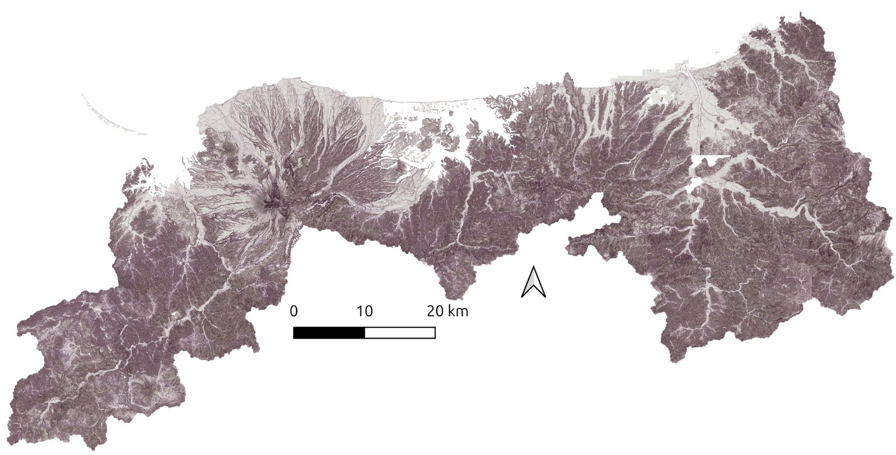

---

## 背景

鳥取県内では、平成30年から令和5年にかけて航空レーザ測量が実施され、ほぼ全域の撮影が完了した。当初はこのデータを使って、たたら製鉄跡地や古墳を解析する計画だった。しかし配布データには次の3つの品質上の問題が見つかった。

1. データ変換時の誤り（図郭・形式の不一致）
2. 市町村境界上のデータ欠損
3. 地表面点群の密度不足に起因する品質低下

そこで、本研究は次の2点を目的とした。

1. 地表面点群の抽出・補間手法を検討すること
2. 全域の点群から DEM を作り直すこと

| | データ変換時の誤り | 市町村境界上の欠損 | 地表面点群の密度不足 |
|---|---|---|---|
| **旧**（県配布版） | 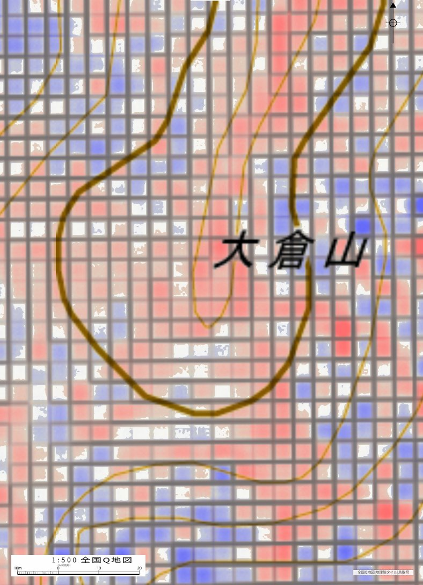 | 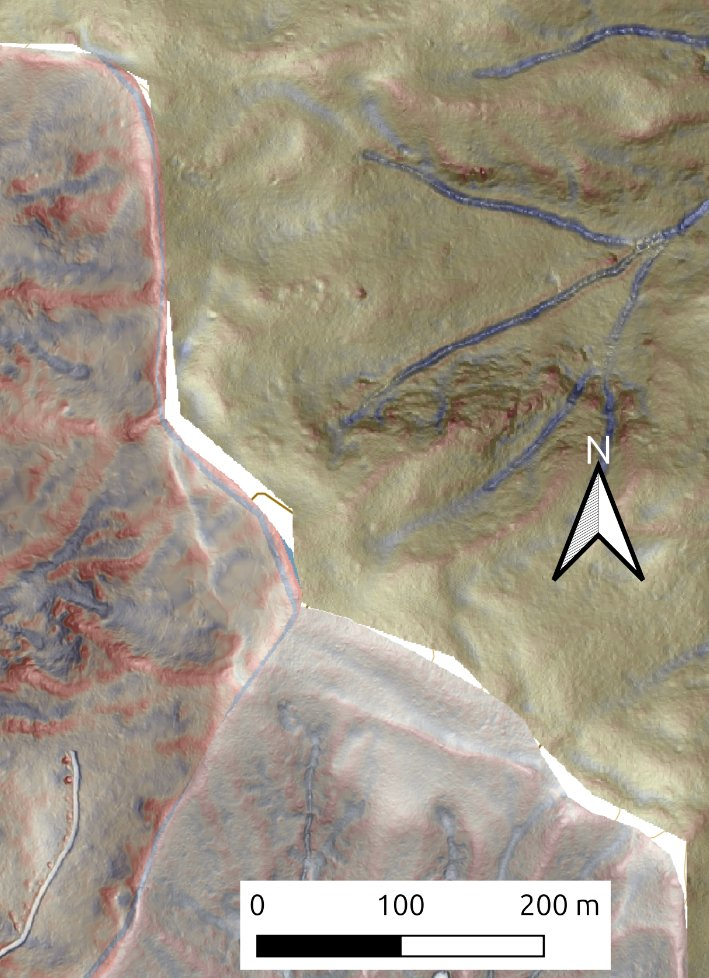 | 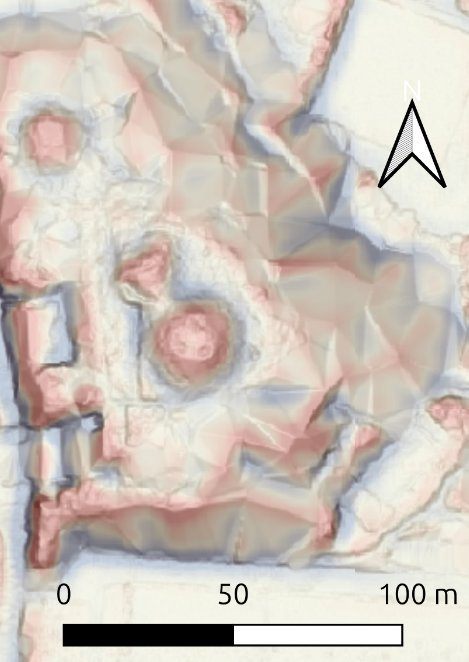 |
| **新**（本リポジトリ） | 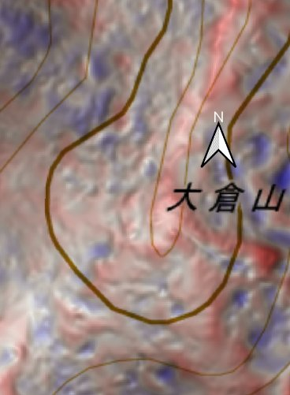 | 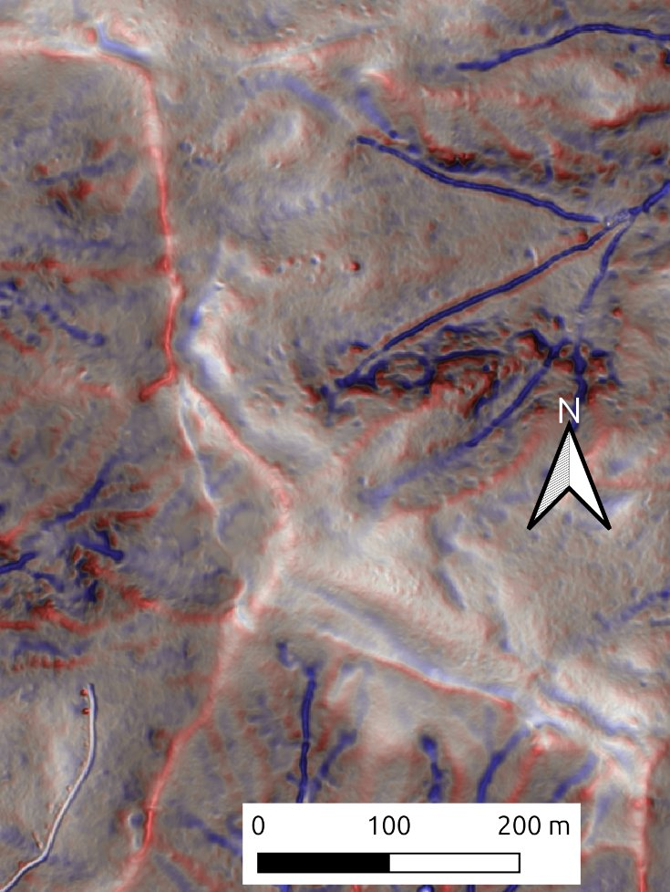 | 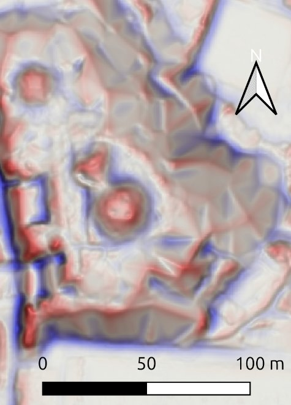 |

---

## 処理の全体像

```
 県提供 LiDAR 点群 (txt / las, 1,296 区画)
        │
        ▼
 [01] 地表面点群の抽出手法の検討 ─── SMRF / PMF / CSF を UAV 計測値と比較
        │   (県配布のグラウンドデータを COPC LAZ に統一)
        ▼
 [02] 地表面点群からの DEM 生成 ──── 補間手法の比較 → TIN（最大辺長 50 m）を採用
        │   DEM・陰影図・CS立体図（0.5 m, EPSG:6673）
        ▼
 [03] 公開用データの作成 ──────── XYZ タイル / 標高 PNG タイル / PMTiles
            → Source Cooperative
```

| 工程 | ディレクトリ | 入力 → 出力 | 状態 |
|---|---|---|---|
| 1. 点群からの地表面データ抽出 | [`01_ground_extraction/`](01_ground_extraction/) | LAS/LAZ → 地表面点 COPC LAZ | 手法比較を完了 |
| 2. 地表面データからの DEM 生成 | [`02_dem_generation/`](02_dem_generation/) | COPC LAZ → DEM・陰影図・CS立体図（GeoTIFF） | 全域で作成済み |
| 3. DEM からの公開用データ作成 | [`03_publishing/`](03_publishing/) | GeoTIFF → XYZ タイル・PMTiles → Source Cooperative | 公開済み |

各工程のスクリプトは、データの置き場所を引数や環境変数で指定する形になっている。点群を持っていれば、別の地域でも同じ手順で処理できる。詳しくは各ディレクトリの README を参照のこと。

---

## 1. 地表面点群の抽出手法の検討

県の点群（オリジナルデータ）に PDAL の地表面フィルタをかけ、抽出した点群を UAV 計測の地表面点群と比較した。UAV データ（無人ヘリコプター、ヤマハ発動機提供）を正解とし、最近傍点距離から RMSE を算出した。

> **注意**: 表1の RMSE は旧版の評価パイプラインで算出した値である。このパイプラインは UAV 点群と抽出点群を結合してから最近傍距離を計算していたため、「抽出点から UAV 地表面までの誤差」を正しく表していない可能性がある。再評価には `01_ground_extraction/scripts/evaluate_ground.py` を使うこと（定義は [01 の README](01_ground_extraction/README.md) を参照）。

| オリジナルデータ | グラウンドデータ（県配布） | UAV データ（基準） | PMF 処理後 | SMRF 処理後 |
|---|---|---|---|---|
| 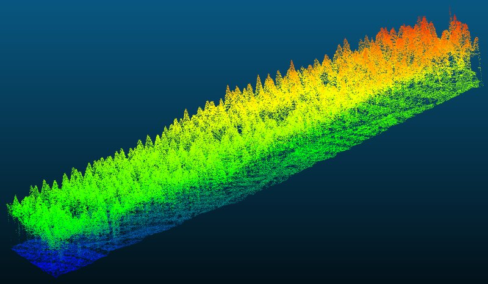 | 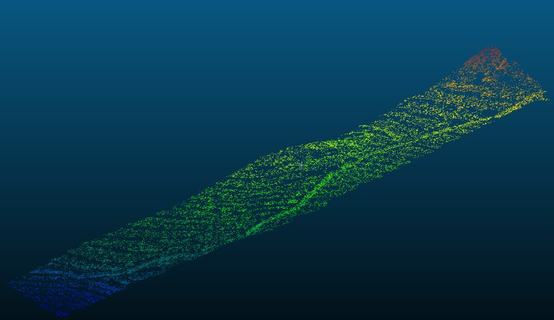 | 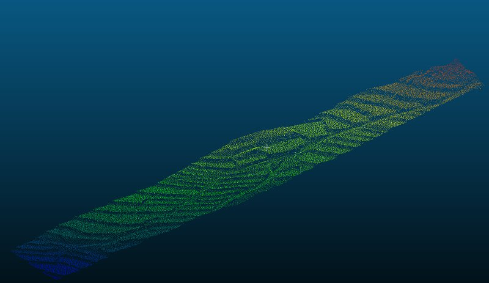 | 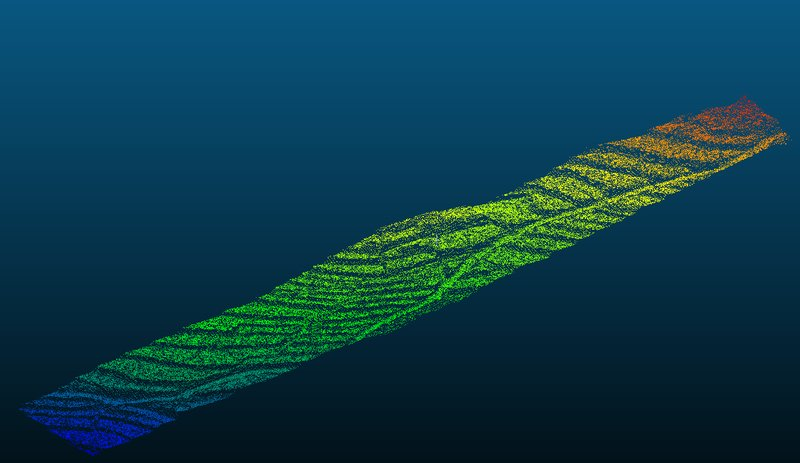 | 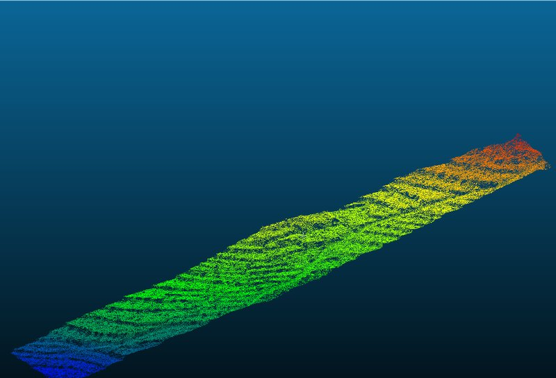 |

**表1. 地域別の SMRF・PMF による抽出点数と精度**

| | 鳥取市河内 | 鳥取市佐治町 | 日南町上萩山 | 日南町野呂山 | 八頭町 | 全地域 |
|---|---:|---:|---:|---:|---:|---:|
| SMRF 抽出点数 | 515,988 | 3,642,202 | 2,864,184 | 1,269,538 | 5,323,911 | 13,615,823 |
| PMF 抽出点数 | 290,621 | 3,194,663 | 2,786,893 | 1,176,559 | 5,187,835 | 12,636,571 |
| SMRF の RMSE | 31.23 cm | 17.13 cm | 17.53 cm | 25.83 cm | 14.77 cm | 21.30 cm |
| PMF の RMSE | 36.65 cm | 16.38 cm | 18.00 cm | 26.21 cm | 15.13 cm | 22.47 cm |

- 抽出点数はすべての地域で SMRF が PMF を上回った。
- RMSE は全地域で見ると SMRF の方が小さい。ただし佐治町だけは PMF の方が小さい。
- SMRF 処理後の点群には、樹冠頂部を地表面と誤判定したとみられる箇所が残った（下図）。

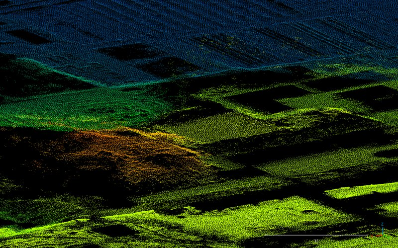

採用したパラメータ（`01_ground_extraction/config/params.json`）は次のとおり。

| 手法 | パラメータ |
|---|---|
| SMRF | slope 0.15, window 18.0, threshold 0.5, scalar 1.25 |
| PMF | max_window_size 33, slope 1.0, max_distance 2.5, initial_distance 0.15, cell_size 1.0 |
| CSF | resolution 1.0, threshold 0.5, rigidness 3, iterations 500 |

---

## 2. DEM の生成

### 2-1. 補間手法の比較（PDAL / PDAL+GDAL）

グラウンドデータ（ALS）と UAV データのそれぞれから DEM を作り、6 種類の補間手法を比較した。

- PDAL: `idw`, `mean`
- PDAL+GDAL（PDAL で COPC LAZ を読み、GDAL で格子化）: `linear`, `average`, `invdist`, `nearest`

| | idw | mean | linear | average | invdist | nearest |
|---|---|---|---|---|---|---|
| ALS | 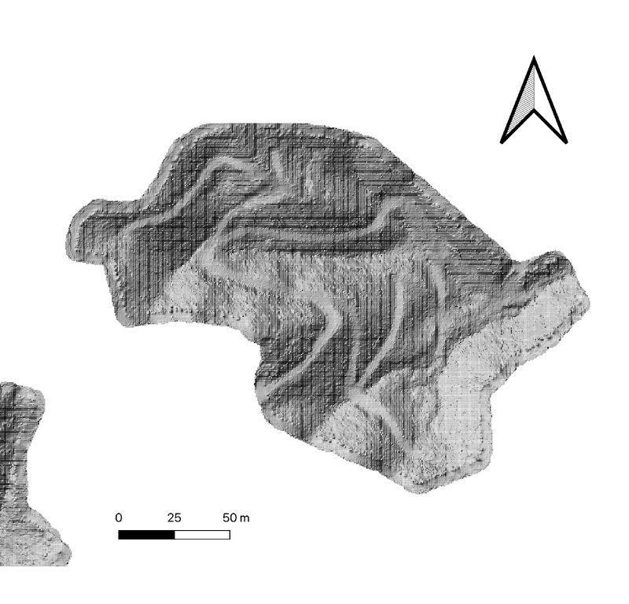 | 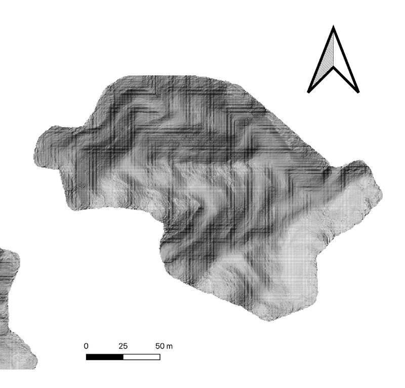 | 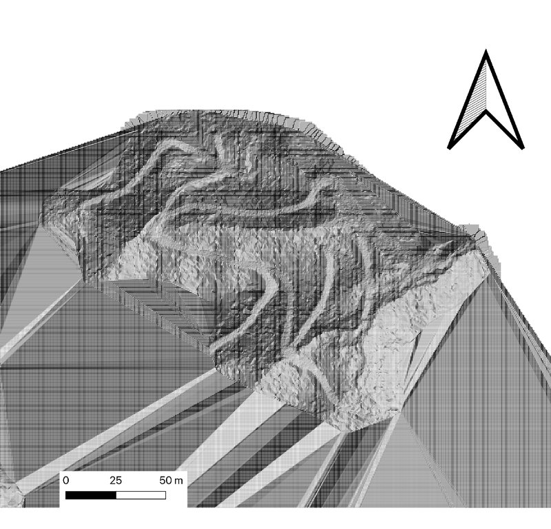 | 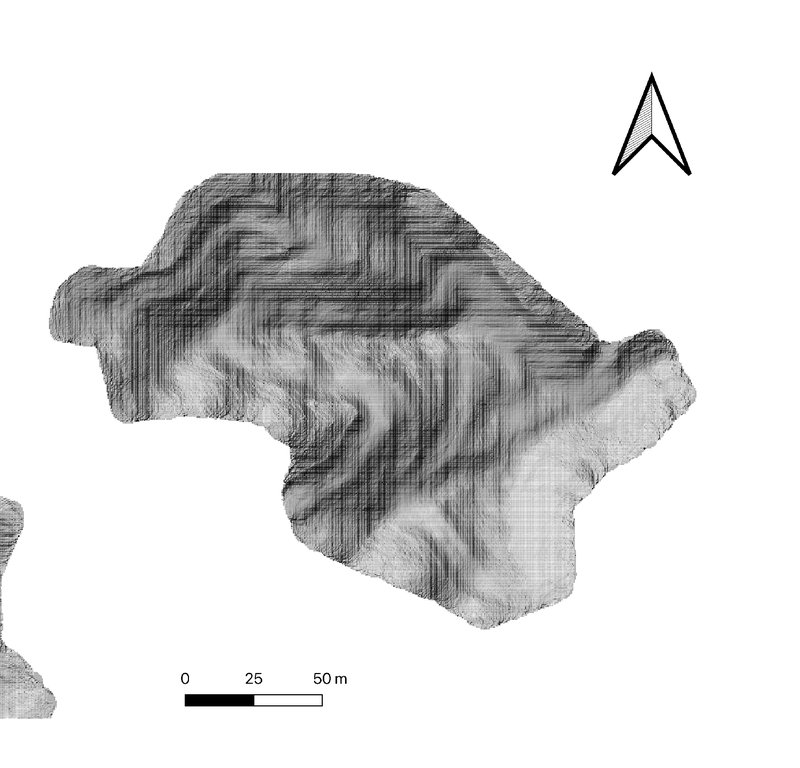 | 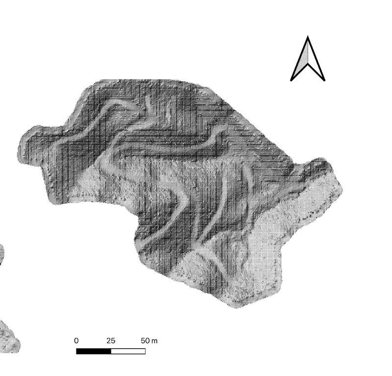 | 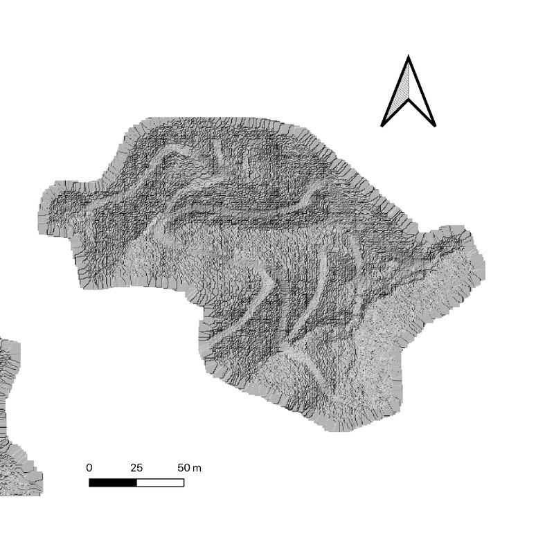 |
| UAV | 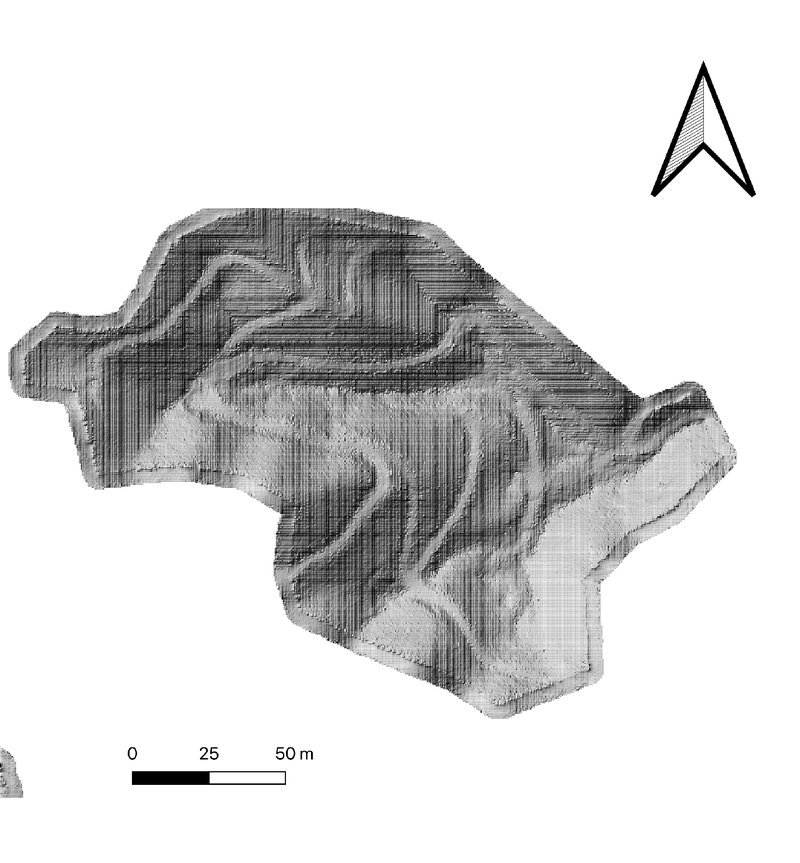 | 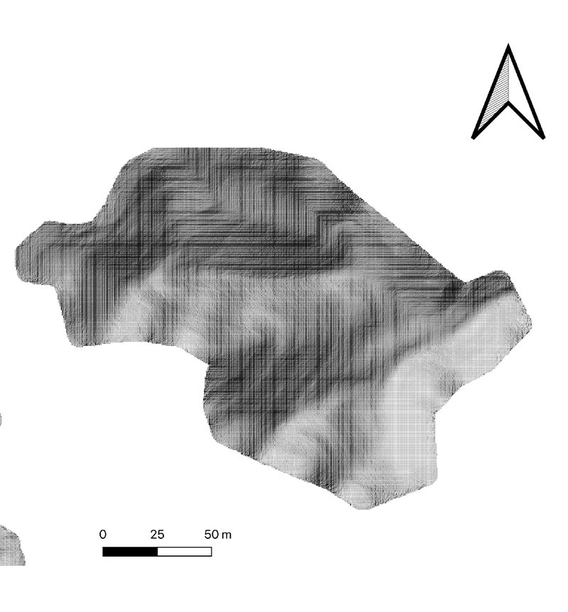 | 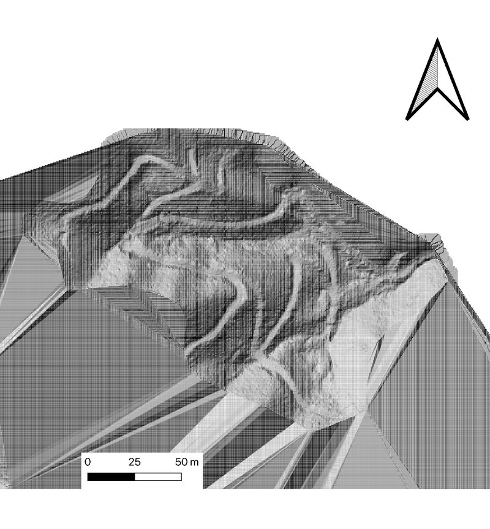 | 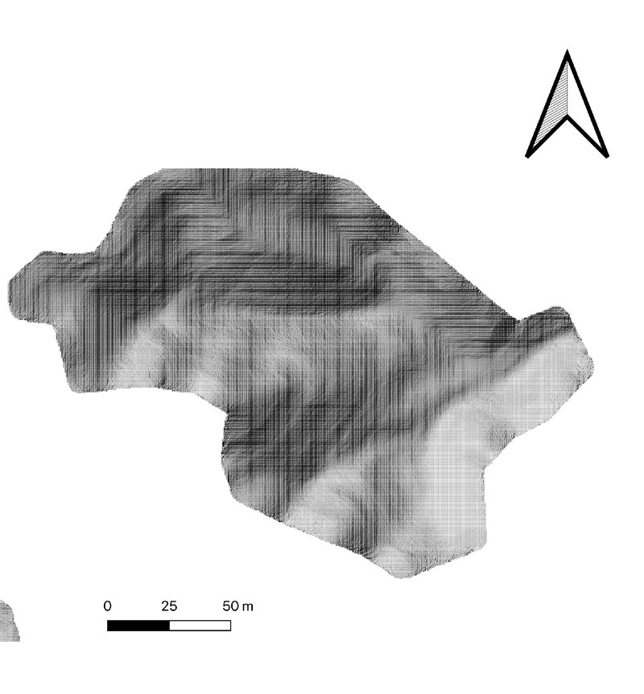 |  | 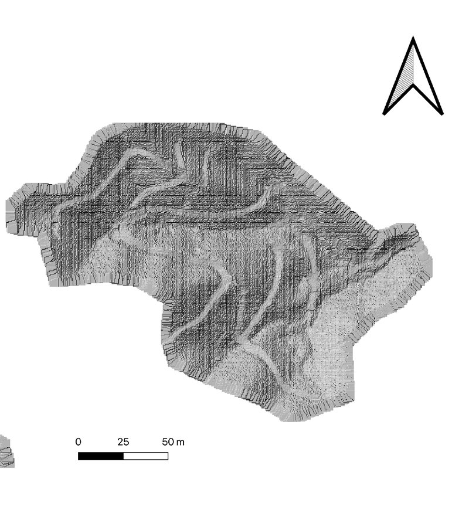 |

部分的な比較では IDW が優れていた。しかし斜面形状の乱れや、実在しない地物が生じた。

### 2-2. PDAL 内での再比較

PDAL に絞り、`idw`・`Tin` を残したうえで `BSpline`・`RobustMLS`・`NaturalNeighbor` を加えて再比較した。その結果、**TIN を採用**した。

| idw | Tin | BSpline | NaturalNeighbor | RobustMLS |
|---|---|---|---|---|
| 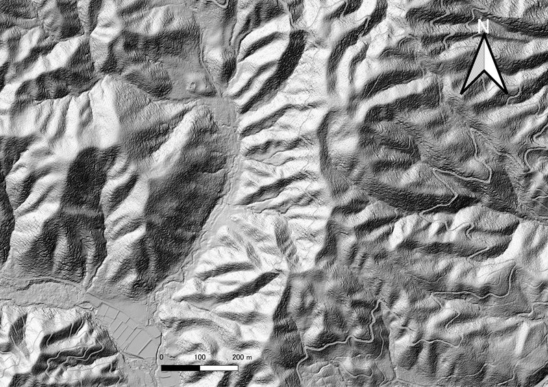 |  | 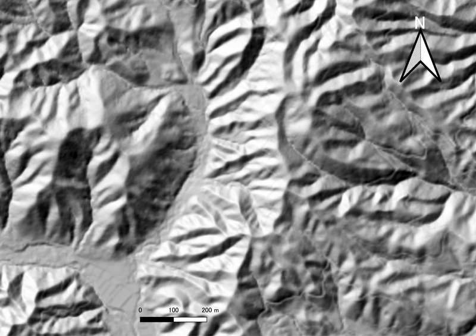 |  |  |

### 2-3. 全域 DEM の作成

| 項目 | 値 |
|---|---|
| 入力 | 県提供 LiDAR 地表面点群 1,296 区画（`Withheld == 0` の点のみ） |
| 補間 | PDAL `filters.delaunay` + `filters.faceraster`（TIN） |
| 最大三角形辺長 | 50 m（辺が 50 m を超える三角形はラスタ化せず NoData とする） |
| 区画境界処理 | 周囲最大 9 区画を読み込み、5 m のバッファを付けて TIN を作成した後、対象区画に切り戻す |
| 解像度・範囲 | 0.5 m、256,000 列 × 126,000 行 |
| 座標系 | EPSG:6673（JGD2011 / 平面直角座標系 第V系） |
| 陰影図 | GDAL `hillshade`（方位 315°、高度 45°、Z 倍率 1） |
| CS立体図 | 傾斜（σ=0.75 m）＋曲率（σ=2.25 m、係数 1.1）の合成 |

注意点:

- 50 m はあくまで TIN の辺長の上限である。標高差の許容値ではない。
- 点密度が低い領域（水田・池など）は NoData になる。
- 区画境界の標高差は大幅に減ったが、一部は残っている。
- 元点群の分類精度は検証していない。

---

## 3. 公開用データの作成

作成した DEM・陰影図・CS立体図をタイル化し、Source Cooperative で公開した。

- XYZ タイル（z8–18）: 標高PNG（地理院形式、0.01 m 分解能）、陰影図、CS立体図
- 同じタイルを格納した PMTiles（1レイヤ 1ファイル）
- 公開先: https://source.coop/wata909/tottori-dem05-csmap
- ビューア: https://data.source.coop/wata909/tottori-dem05-csmap/index.html

---

## クイックスタート

```bash
git clone <this repository> && cd tottori-dem05-csmap
conda env create -f environment.yml && conda activate tottori-dem

# 1. 地表面点の抽出（点群フォルダ → COPC）
python 01_ground_extraction/scripts/extract_ground.py /data/laz -o /data/ground --method smrf --workers 4

# 2. DEM・陰影図・CS立体図
python 02_dem_generation/scripts/make_inventory.py /data/ground -o /data/work/inventory.json --epsg 6673
python 02_dem_generation/scripts/tin_dem.py --inventory /data/work/inventory.json --output /data/work/dem
python 02_dem_generation/scripts/final_qa.py /data/work/dem/ground --overviews
python 02_dem_generation/scripts/make_csmap.py /data/work/dem/ground/DEM/ground_TIN_0p5m.tif /data/work/csmap/ground_CSMap_0p5m.tif

# 3. タイル化（DATA_DIR からの相対パスで入力を指定）
cd 03_publishing
DATA_DIR=/data/work SRC_DEM=dem/ground/DEM/ground_TIN_0p5m.tif \
  SRC_HS=dem/ground/DEM_hillshade/ground_TIN_hillshade.tif SRC_CS=csmap/ground_CSMap_0p5m.tif \
  DRYRUN=1 bash scripts/make_all_tiles.sh
```

上の `ground` は工程2の入力フォルダ名（グループ名）である。まず `tin_dem.py --only <図郭>` やタイル作成の `DRYRUN=1` で、小さな範囲から試すこと。

## リポジトリ構成

```
tottori-dem05-csmap/
├── README.md
├── environment.yml           conda 環境（PDAL ≥ 2.10, GDAL ≥ 3.13, NumPy, SciPy, pmtiles）
├── docs/                     ポスターと図版
├── 01_ground_extraction/
│   ├── config/               params.json（手法パラメータ）, samples.example.json
│   └── scripts/              extract_ground / convert_text / evaluate_ground / run_samples
├── 02_dem_generation/
│   └── scripts/              make_inventory / tin_dem / check_seams / final_qa / make_csmap / test_edge_limit
└── 03_publishing/
    ├── scripts/              config.sh / make_all_tiles / gsi_dem_tiles / make_all_pmtiles / xyz_to_pmtiles /
    │                         verify_* / upload_sourcecoop
    ├── viewer/index.html     Leaflet ビューア
    └── docs/                 Source Cooperative 用 README
```

点群・DEM・タイルなどのデータはリポジトリに含めない。鳥取県の点群は県（林政企画課）への請求で提供を受けたもので、公開 URL はない。作成済みの成果は Source Cooperative で公開している。

## 動作環境

Linux（PDAL 2.10.2、GDAL 3.13.3、Python 3.12）で、合成データを使って全工程の動作を確認した。工程3は macOS でも本番処理を行っている。Windows では、Python スクリプトは conda 環境で動く想定である。シェルスクリプト（工程3）は WSL か Git Bash で実行すること。

## ライセンス

- **データ**: CC BY 4.0（作成: 鳥取大学 地理情報科学研究室）
- **コード**: （未定）

出典: 本データの作成には、鳥取県が実施した航空レーザ測量成果を使用した。国土地理院の承認番号は Source Cooperative のページを参照のこと。

## 謝辞

本研究で使用した点群データは、鳥取県林政企画課から提供を受けた。UAV 計測データはヤマハ発動機株式会社から提供を受けた。本研究は JSPS 科研費 JP25K21880 の助成を受けた。

## 連絡先

鳥取大学 農学部 地理情報科学研究室
geo_info_science@mail.muses.tottori-u.ac.jp
